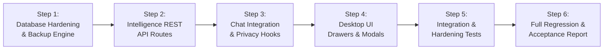

# HINAKU — Phase 1, Milestone 7 Implementation Plan
## Integration, Desktop UI & Hardening (Final Architecture & Operational Specification)

**Milestone:** Milestone 7 — Integration, Desktop UI & Hardening  
**Parent Document:** [`docs/PHASE_1_MASTER_IMPLEMENTATION_PLAN.md`](file:///d:/HINAKU-AI/docs/PHASE_1_MASTER_IMPLEMENTATION_PLAN.md)  
**Target Branch:** `phase-1-intelligence-foundation`  
**Status:** Final Plan Submitted for Explicit Owner Review & Approval (Planning & Documentation Only — Zero Implementation Code)  
**Date of Revision:** November 21, 2026  

---

## 1. Executive Summary & Final Plan Corrections

Following explicit owner review, this implementation plan incorporates five critical operational, database, security, and verification corrections:

1. **Temporary Workspace Permission Enforcement (Correction 1):** Temporary workspaces are not exempt from HINAKU's file-modification approval policy. Workspace write and delete permissions are disabled by default. The owner must explicitly grant permission for the designated workspace and operation scope. Read, write, and delete permissions remain strictly separated. Permissions are restricted to authorized canonical paths, bound to the relevant task/session, and fully revokable. Automatic cleanup may delete only files HINAKU had explicit permission to create/delete, and no workspace grant ever accesses unrelated files.
2. **Coordinated Multi-Database Backup Consistency (Correction 2):** SQLite's backup API guarantees consistency for an individual file, but both `data/hinaku.db` and `data/chroma/chroma.sqlite3` must represent a mutually consistent application state. The backup protocol coordinates every application write path affecting either database (FastAPI requests, background scheduler jobs, interaction loggers, and ChromaDB vector operations). It acquires a global coordination lock, safely drains or pauses outstanding in-flight writes, queues incoming write operations during the snapshot window, verifies both snapshots independently, and resumes queued operations only after successful promotion or safe failure handling. An incomplete or inconsistent pair is never labeled a valid recovery set.
3. **Safe Restore Failure and Rollback Protocol (Correction 3):** If replacing one database succeeds but replacing the other fails during restoration, HINAKU prevents partial-state execution. The application remains stopped throughout restoration; both live databases are preserved before replacement; databases are restored as a coordinated pair; and both are verified via `PRAGMA integrity_check;`. If either replacement fails or fails integrity verification, the system initiates a controlled rollback to the preserved original pair and re-verifies. If rollback itself fails, the system remains completely stopped, preserves all forensic data, and alerts the owner.
4. **Qualitative Non-Regression & Current-Suite Verification (Correction 4):** All arbitrary and historical test-count requirements (such as "85 intelligence tests" or "350+ baseline tests") are eliminated. Acceptance criteria require executing the complete current test suite, preserving existing behavior and assertions, actively investigating and resolving any regression introduced by Milestone 7, documenting reasons for any skipped tests, and reporting actual test results directly from the current repository state.
5. **Enhanced Architecture Diagram with ImprovementProposalEngine (Correction 5):** The system architecture diagram explicitly details `ImprovementProposalEngine` alongside `ExperienceLogger` and `WeaknessCatalog` within the controlled learning architecture, correctly portraying proposals as non-autonomous recommendations requiring explicit owner review and decision without autonomous deployment authority.

---

## 2. Objective and Scope

Milestone 7 is the final milestone of **Phase 1: Foundation for Independent Intelligence**.

The objective is to integrate the intelligence engines developed across Milestones 1–6 into HINAKU's runtime, desktop presentation shell, and persistence layers:
- **API Integration:** Connect the Intelligence Core into `/api/chat` and expose structured REST endpoints for projects, tasks, and controlled learning.
- **Desktop UI Drawers & Views:** Surface Project intelligence, Task coordination, and Observational Learning drawers/views in the desktop web UI (`ui/app.js`, `ui/index.html`, `ui/js/pages.js`).
- **Multi-Database Reliability & Hardening:** Enforce dual-database startup integrity verification (`PRAGMA integrity_check;`) and coordinated recovery set snapshots via SQLite Online Backup (`sqlite3.Connection.backup`) in `data/backups/`.
- **Loopback & Anti-Regression Verification:** Ensure seamless end-to-end message flow, strict preservation of the six critical owner approval categories, and complete regression verification across all existing test suites.

---

## 3. Current Implemented Baseline vs. Proposed Milestone 7 Scope

To prevent duplicate abstractions or redundant engine implementations, the boundary between existing assets and Milestone 7 integration adapters is strictly delineated:

| Intelligence Domain | Existing Implemented Assets (Milestones 1–6) | Proposed Milestone 7 Integration Scope |
| :--- | :--- | :--- |
| **Intelligence Architecture** | [`backend/intelligence/types.py`](file:///d:/HINAKU-AI/backend/intelligence/types.py), [`context.py`](file:///d:/HINAKU-AI/backend/intelligence/context.py), [`errors.py`](file:///d:/HINAKU-AI/backend/intelligence/errors.py) | Wire `IntelligenceContext` into FastAPI dependency injection and active request scope. |
| **Project Intelligence** | [`ProjectEngine`](file:///d:/HINAKU-AI/backend/intelligence/project_engine.py), [`ProjectStore`](file:///d:/HINAKU-AI/backend/intelligence/project_store.py), [`RepoGrounding`](file:///d:/HINAKU-AI/backend/intelligence/repo_grounding.py) | Expose REST endpoints in `backend/api/projects.py`; render Project Drawer in `ui/app.js` and `ui/js/pages.js`. |
| **Memory & Knowledge Graph** | [`DomainRouter`](file:///d:/HINAKU-AI/backend/intelligence/domain_router.py), [`KnowledgeGraph`](file:///d:/HINAKU-AI/backend/intelligence/knowledge_graph.py), [`ContradictionManager`](file:///d:/HINAKU-AI/backend/intelligence/contradiction_manager.py) | Hook `DomainRouter` into `/api/chat` request turn to synthesize isolated `ContextBundle`. |
| **Decision & Planning** | [`DecisionEngine`](file:///d:/HINAKU-AI/backend/intelligence/decision_engine.py), [`PlanningEngine`](file:///d:/HINAKU-AI/backend/intelligence/planning_engine.py), [`TaskManager`](file:///d:/HINAKU-AI/backend/intelligence/task_manager.py) | Expose REST endpoints in `backend/api/tasks.py`; render Task Drawer and Scoped Approval Modal in UI. |
| **Model Orchestration** | [`ModelOrchestrator`](file:///d:/HINAKU-AI/backend/intelligence/model_orchestrator.py), [`ModelRegistry`](file:///d:/HINAKU-AI/backend/intelligence/model_registry.py), [`CapabilityAssessor`](file:///d:/HINAKU-AI/backend/intelligence/capability_assessor.py) | Connect orchestration into `/api/chat` execution pipeline with hardware capability matching and privacy-gated fallback. |
| **Controlled Learning** | [`ExperienceLogger`](file:///d:/HINAKU-AI/backend/intelligence/experience_logger.py), [`WeaknessCatalog`](file:///d:/HINAKU-AI/backend/intelligence/weakness_catalog.py), [`ImprovementProposalEngine`](file:///d:/HINAKU-AI/backend/intelligence/improvement_engine.py) | Ingest feedback from `/api/interactions` and `/api/chat`; expose observational learning endpoints and UI review view. |
| **Database Persistence** | Separate SQLite stores (`hinaku.db`, Chroma vector store) | Unify connection management; add dual-database startup integrity checks and `DatabaseBackupManager` for coordinated recovery sets. |

---

## 4. Integration Architecture & System Diagram (Correction 5)

```mermaid
flowchart TD
    subgraph UI ["Desktop Presentation Layer (ui/)"]
        ChatUI["Chat Interface (Center Stage)"]
        ProjDrawer["Project Drawer / View<br/>(Confidentiality, Repo Index, Decisions)"]
        TaskDrawer["Task Drawer / View<br/>(DAG Dependencies, Priority, Status)"]
        ApprovalModal["'Review & Approve Action' Modal<br/>(Target Resource, Operation, Scope, Impact)"]
        LearningView["Observational Learning View<br/>(Sanitized Experiences, Weaknesses, Proposals)"]
    end

    subgraph API ["FastAPI Endpoint Layer (backend/api/)"]
        AuthMid["require_session_auth<br/>(Validates X-Hinaku-Token via auth.py)"]
        ChatAPI["/api/chat (POST)<br/>(Streaming chat with intelligence context)"]
        ProjAPI["/api/projects (GET, POST, PATCH)<br/>(Project registration, context bundles)"]
        TaskAPI["/api/tasks (GET, POST, PATCH)<br/>(Task lifecycle transitions)"]
        ApproveAPI["POST /api/tasks/{id}/approve<br/>(Scoped owner authorization of critical actions)"]
        LearnAPI["/api/learning (GET, POST, DELETE)<br/>(Audit trail & proposal owner decision)"]
        BackupAPI["/api/settings/backup (POST, GET)<br/>/api/settings/backup/restore (POST)"]
    end

    subgraph Orchestration ["Intelligence Orchestration & Domain Routing"]
        ContextInj["Context Injection Engine<br/>(Explicit Project Selection > Auto-Discovery)"]
        DomainRouter["DomainRouter<br/>(Enforces Personal vs Project Isolation)"]
        ModelOrch["ModelOrchestrator<br/>(Hardware Ceilings, Sequential Verification)"]
    end

    subgraph Security ["Physical Privacy & Safety Boundaries"]
        PrivGate{"OutboundPrivacyGate<br/>(verify_outbound_payload)"}
        ActionGuard{"Critical Action Guard<br/>(assert_owner_session_required)"}
        PersonaGuard{"Core Persona Immutability<br/>(config/hinaku_persona.md)"}
    end

    subgraph Engines ["Core Intelligence Engines (Milestones 1–6)"]
        ProjectEngine["ProjectEngine & RepoGrounding"]
        TaskManager["TaskManager & PlanningEngine"]
        DecisionEngine["DecisionEngine & KnowledgeGraph"]
        
        subgraph LearningSystem ["Controlled Learning Architecture"]
            ExpLogger["ExperienceLogger<br/>(Sanitized Observations)"]
            WeakCatalog["WeaknessCatalog<br/>(Pattern Analysis)"]
            PropEngine["ImprovementProposalEngine<br/>(Grounded Proposals)"]
            
            ExpLogger --> WeakCatalog
            WeakCatalog --> PropEngine
        end
    end

    subgraph Persistence ["Hardened Multi-Database Storage Layer (data/)"]
        HinakuDB[("Primary Relational DB<br/>data/hinaku.db<br/>(Conversations, Tasks, Projects, Graph)")]
        ChromaDB[("Vector SQLite DB<br/>data/chroma/chroma.sqlite3<br/>(Semantic Embeddings)")]
        BackupMgr["DatabaseBackupManager<br/>- Coordinated Multi-Path Write Quiescence<br/>- Dual PRAGMA integrity_check on boot<br/>- Paired Staged Snapshots (hinaku + chroma)<br/>- Never delete last known-good set<br/>- Controlled Rollback on Restore Failure"]
    end

    ChatUI --> ChatAPI
    ProjDrawer --> ProjAPI
    TaskDrawer --> TaskAPI
    ApprovalModal --> ApproveAPI
    LearningView --> LearnAPI
    BackupAPI --> AuthMid

    ProjAPI --> AuthMid
    TaskAPI --> AuthMid
    ApproveAPI --> AuthMid
    LearnAPI --> AuthMid

    ChatAPI --> ContextInj
    ContextInj --> DomainRouter
    DomainRouter --> ModelOrch

    ModelOrch -->|Local Target| Ollama["OllamaAdapter (On-device GPU)"]
    ModelOrch -->|Cloud Target| PrivGate
    PrivGate -->|Permitted & Redacted| CloudLLM["ApiAdapter (External Provider)"]
    PrivGate -->|Confidential / Personal| HaltCloud["Halt (Never fallback to cloud)"]

    ApproveAPI --> ActionGuard
    ActionGuard --> TaskManager

    ProjAPI --> ProjectEngine
    TaskAPI --> TaskManager
    LearnAPI --> ExpLogger
    LearnAPI --> WeakCatalog
    LearnAPI --> PropEngine
    PropEngine -.->|Owner Review & Decision Only<br/>(No Autonomous Deploy)| ApprovalModal

    ProjectEngine --> HinakuDB
    TaskManager --> HinakuDB
    DecisionEngine --> HinakuDB
    ExpLogger --> HinakuDB
    WeakCatalog --> HinakuDB
    PropEngine --> HinakuDB

    HinakuDB --> BackupMgr
    ChromaDB --> BackupMgr
```

---

## 5. Security & Owner Authorization Architecture

### 5.1 The Established Six Critical Action Categories
In strict adherence to HINAKU security policies established in Sprint 0B and Milestone 4 (`backend/intelligence/decision_types.py`), the following six categories unconditionally halt execution and require explicit, active owner desktop session authorization via `assert_owner_session_required()`:

1. **File Modification and Deletion:**
   - *Granular Permissions:* Read operations (`repo_grounding.py`) are strictly read-only within authorized project boundaries. Write, create, and delete operations on host files outside designated authorized workspaces are categorized as Critical Action 1.
   - *Temporary Workspace Boundaries:* Temporary workspaces are **not exempt** from file-modification approval policies (see Section 5.3).
2. **Financial Transactions and Purchases:** Unconditionally forbidden for autonomous initiation or execution under any mode.
3. **External Communications:** Outbound emails, messaging, SMS, phone calls, or social platform dispatches.
   - *Clarification:* Standard outbound HTTP calls to configured LLM inference endpoints (Anthropic, OpenRouter) governed by `OutboundPrivacyGate` are technical inference requests, not "external communications" to third parties. However, sending messages to external human recipients is strictly Critical Action 3.
4. **System Operations:** Host operating system shell execution, software/package installation (`pip`, `npm`, `cargo`, `apt`), service daemon manipulation, and system security setting alterations.
5. **Identity and Security Changes:** Modification of passwords, session tokens, master keys, encryption keys, authorization scopes, or user accounts.
6. **Core Self-Modification:** Any attempt to modify core identity prompt (`config/hinaku_persona.md`), privacy gate logic (`privacy_gate.py`), authentication enforcement (`auth.py`), or autonomy/approval boundaries.

**Non-Bypass Invariants:**
- Background tasks (`backend/scheduler/service.py`) running with scoped internal tokens are strictly blocked from authorizing or executing these six categories.
- "Full Auto Mode" or automated plan execution engines cannot override or bypass these boundaries.

---

### 5.2 Explicit and Scoped Owner Approval Model
The task approval endpoint `POST /api/tasks/{id}/approve` does not act as an unconstrained boolean toggle. It implements an explicit, scoped approval contract:

```python
class TaskApprovalRequest(BaseModel):
    action_hash: str              # SHA-256 hash of (task_id + action_category + target_resource + operation_payload)
    target_resource: str          # Exact file path, service, or API being touched
    operation: str                # Specific operation (e.g., 'delete_file', 'modify_config')
    scope_parameters: Dict[str, Any] # Bounded parameters (e.g., lines to edit, destination path)
    confirmed: bool               # Explicit checkbox / confirmation toggle
```

**Approval Invariants:**
1. **Authenticated Session Only:** Must be invoked by an authenticated owner presenting a valid `X-Hinaku-Token` originating from the active desktop session. Internal background tokens are rejected.
2. **Contextual Binding (Action Hash):** The approval is cryptographically bound to the specific target resource, operation, and parameters.
3. **Automatic Invalidation on Mutation:** If the task description, dependencies, target resource, or parameters are modified after an approval is granted, the task automatically reverts to `PENDING_APPROVAL`, invalidating previous approvals.
4. **One-Time Use:** An approval is valid only for the execution of the specific task transition authorized and cannot be reused for subsequent or sibling tasks.
5. **Execution Guard Verification:** The execution worker verifies the action hash immediately prior to executing the operation.
6. **Desktop UI Representation:** The button is labeled **`Review & Approve Action`**. Clicking opens an inspection modal displaying:
   - Target Resource & Path
   - Action Category
   - Expected Impact & Irreversible Consequences
   - Exact Parameters / Diff

---

### 5.3 Temporary Workspace Permission Enforcement (Correction 1)

Temporary workspaces are **not exempt** from HINAKU's file-modification approval policy. The system enforces strict permission boundaries across temporary filesystem areas:

1. **Disabled by Default:**
   - Workspace write, create, and delete permissions are disabled by default.
   - HINAKU possesses no default or implicit authority to write or delete files in temporary locations without explicit owner authorization.
2. **Explicit Owner Grant & Scoped Operation:**
   - The owner must explicitly grant permission for the designated temporary workspace and operation scope.
   - File read, write, and delete permissions remain strictly separated. Granting read permission does not grant write permission, and granting write permission does not grant delete permission.
3. **Authorized Canonical Path Boundaries:**
   - Permissions are strictly restricted to verified canonical paths:
     - Global temporary scratchpads: `<repo_root>/data/temp/` and `<repo_root>/hinaku_temp/`.
     - Project-scoped build scratchpads: `<project_root>/.hinaku_build/` or explicit scratch paths configured in `ProjectStore`.
   - Path canonicalization (`os.path.realpath` / `pathlib.Path.resolve()`) is enforced before any operation. Relative path traversals (`..`), symbolic links escaping the designated workspace, and absolute paths outside the workspace boundary are rejected immediately.
4. **Task/Session Bound and Immediate Revokability:**
   - Workspace permission grants are bound to the specific task execution or interactive session with an explicit time-to-live (TTL).
   - Grants expire immediately upon task transition out of `IN_PROGRESS`.
   - The owner may revoke active workspace permissions at any time via the API or desktop UI.
5. **Strict Cleanup Scope:**
   - Automated post-task cleanup may delete **only** files that HINAKU was explicitly granted permission to create and delete during the active task.
   - Pre-existing files, user-authored documents, and files created outside the granted scope are never eligible for automated deletion.
6. **Complete Isolation from Unrelated Files:**
   - No temporary workspace permission ever grants access, exemptions, or overrides to files outside the designated workspace. Core codebase files (`backend/`, `ui/`, `config/`), the persona prompt, security policies, and persistent databases are physically unreachable through workspace grants.

---

## 6. Privacy & Chat Integration Architecture

### 6.1 Project Context Injection & Precedence
1. **Explicit Precedence:** When an owner selects a project in the UI (or passes `project_id` in `/api/chat`), this explicitly chosen project context **unconditionally supersedes** automatic repository or project detection heuristics.
2. **Access & Domain Permission Gate:** Before retrieving project context, `DomainRouter` validates that the conversation has permission to access the `PROJECT` domain and that the project is active (not soft-deleted).

### 6.2 Outbound Privacy Gate Enforcement
1. **Physical Boundary on Every Outbound Path:** Every code path invoking cloud models—whether via `ModelOrchestrator`, legacy `ModelRouter`, or direct `ApiAdapter`—must execute `OutboundPrivacyGate.verify_outbound_payload()`.
2. **Confidential & Restricted Project Protection:**
   - If `project.confidentiality == CONFIDENTIAL`, cloud execution is unconditionally blocked.
   - If `project.confidentiality == RESTRICTED`, context is strictly local-only and redacted from telemetry.
3. **No Unprotected Cloud Fallback:** If local model execution fails on a task involving confidential project context or personal memories, the orchestrator **halts and reports failure**. It is physically forbidden from falling back to cloud providers.
4. **Standard Local Pipeline Enforcement:** The local inference pipeline must strictly respect sensitive data guards and never echo or log unredacted credentials.

---

## 7. Multi-Database Integrity, Hardening, and Coordinated Recovery (Corrections 2 & 3)

### 7.1 Multi-Database Scope
HINAKU maintains persistent state across two SQLite databases in the application data directory:
1. `data/hinaku.db`: Primary relational store (conversations, messages, interactions, memories, attachments, projects, knowledge graph, tasks, weaknesses, and improvement proposals).
2. `data/chroma/chroma.sqlite3`: Vector index metadata store supporting semantic memory embeddings.

Both databases are managed under a unified integrity, backup, and recovery framework.

---

### 7.2 Startup Integrity Verification (Fail-Closed)
1. During FastAPI lifespan startup in `backend/main.py`, `DatabaseBackupManager.verify_startup_integrity()` executes:
   ```sql
   PRAGMA integrity_check;
   ```
   against both `data/hinaku.db` and `data/chroma/chroma.sqlite3`.
2. **Fail-Closed Policy:** Both databases must return `ok`. If either database fails integrity check (e.g., corruption, malformed pages, disk error):
   - Application startup halts immediately with a non-zero exit or error state.
   - No requests are served.
   - Damaged database files are **never overwritten, deleted, or automatically repaired**.
   - The damaged files are preserved in place for manual inspection and forensic recovery.
   - The system logs a detailed error identifying exactly which database failed and the PRAGMA output.

---

### 7.3 Coordinated Multi-Database Backup Consistency Protocol (Correction 2)
SQLite's Online Backup API provides transactional consistency for an individual database file, but `data/hinaku.db` and `data/chroma/chroma.sqlite3` must also reflect a mutually consistent application state. The backup protocol coordinates all writers:

1. **Comprehensive Write-Path Coordination:**
   - The system identifies every application write path affecting either database:
     - Primary relational writes: `/api/chat` message turns, project updates, task mutations, and experience logging.
     - Background writes: `backend/scheduler/service.py` background tasks and periodic curation jobs.
     - ChromaDB vector writes: embedding extraction, index updates, and semantic memory collection mutations.
   - The system does **not** assume that a lock covering only one database coordinates every writer.
2. **Coordination Lock & Safe Drain:**
   - `DatabaseBackupManager` acquires a global coordinated backup lock.
   - Outstanding in-flight write operations are allowed to complete safely, or are briefly paused before snapshots begin.
   - Incoming write operations across both databases are queued or safely paused during the snapshot window.
3. **Atomic Paired Staging via SQLite Online Backup:**
   - Snapshots for both databases are created using `sqlite3.Connection.backup()` into a dedicated temporary staging directory:
     - `data/backups/.tmp_recovery_set_<timestamp>/hinaku.db`
     - `data/backups/.tmp_recovery_set_<timestamp>/chroma.sqlite3`
4. **Dual Independent Integrity Verification:**
   - `PRAGMA integrity_check;` is executed independently against both staged database files.
   - Both files must return `ok`.
5. **Atomic Promotion or Safe Failure Handling:**
   - Only when **both** snapshots pass integrity check is the staging directory atomically promoted (renamed) to an immutable recovery set:
     - `data/backups/recovery_set_<timestamp>/` containing `hinaku.db`, `chroma.sqlite3`, and `metadata.json`.
   - If either snapshot fails, the entire staging set is discarded, and the failure is logged.
   - Incomplete or inconsistent pairs are **never** labeled or registered as a valid recovery set.
6. **Resumption of Operations:**
   - Queued write operations are resumed across both databases immediately upon successful promotion or safe failure handling.

---

### 7.4 Safe Recovery Set Retention Policy
1. Retention limit is configurable (default: 5 recovery sets).
2. Pruning operates strictly on **coordinated recovery sets**, never on individual database files.
3. **Inviolable Invariant:** Pruning will **never delete the last verified known-good recovery set**, regardless of age or retention configuration. If only one verified recovery set remains, pruning is unconditionally halted.

---

### 7.5 Safe Restore Failure and Rollback Protocol (Correction 3)
Restoration must handle partial failures safely to prevent database state desynchronization:

1. **HINAKU Remains Stopped:**
   - Restoration is executed exclusively while normal application traffic is halted (offline restoration mode or maintenance mode where all incoming requests and background tasks are paused).
2. **Authorization & Confirmation:**
   - Triggered via `POST /api/settings/backup/restore` requiring an active owner desktop session (`assert_owner_session_required()`). Internal background tokens are rejected.
   - Requires an explicit confirmation payload (`BackupRestoreRequest`).
3. **Pre-Restoration Live State Preservation:**
   - Before modifying live files, current live databases are copied to timestamped preservation locations:
     - `data/hinaku.pre_restore.<timestamp>.db`
     - `data/chroma/chroma.pre_restore.<timestamp>.sqlite3`
4. **Coordinated Pair Restoration:**
   - Both databases are restored as a coordinated pair from the same recovery set. Restoring one database without the other is strictly prohibited.
5. **Post-Restoration Integrity Verification:**
   - `PRAGMA integrity_check;` is run on both newly restored database files.
6. **Controlled Rollback on Restore Failure:**
   - If replacing either database fails (disk full, I/O error, permissions), or if either restored database fails integrity check:
     - The system halts immediately and **does not allow normal application startup**.
     - An automated controlled rollback is executed: both databases are restored from the preserved pre-restoration files (`.pre_restore.<timestamp>`).
     - Post-rollback `PRAGMA integrity_check;` is executed on both rolled-back databases.
   - If rollback itself fails, HINAKU **remains completely stopped**, preserves all available recovery and diagnostic data, logs a critical error, and alerts the owner.
   - Under no circumstances does HINAKU silently continue running with a partially restored, mismatched, or unverified database pair.

---

## 8. Learning API and Controlled Governance

### 8.1 Observational & Owner-Controlled Model
1. The Learning view in the desktop UI and `/api/learning/*` endpoints provide transparency into what HINAKU has observed.
2. The owner can review sanitized feedback records, browse weaknesses, inspect benchmark scores, and approve or reject proposals.
3. Approval of an `ImprovementProposal` does **not** grant authorization for autonomous source code modification, deployment, or model replacement.

### 8.2 Autonomous Execution Restrictions
1. Automatic background deployment of prompt or model changes is forbidden.
2. Self-modification of core identity, persona definitions, or security rules is strictly blocked (`SafetyBoundaryViolation`).

### 8.3 Project Confidentiality Isolation
1. Experience records derived from `CONFIDENTIAL` or `RESTRICTED` projects are tagged with the specific `project_id`.
2. The `ImprovementProposalEngine` and `WeaknessCatalog` **strictly isolate** project-specific experiences: confidential project data is never aggregated into global, cross-project improvement proposals.

### 8.4 Authorized Learning Data Deletion & Full Wipe
1. **Granular Experience Deletion (`DELETE /api/learning/experiences/{id}`):**
   - Requires authenticated owner desktop session (`assert_owner_session_required()`).
   - Nullifies foreign references in weakness records without corrupting the weakness catalog.
2. **Full Learning Data Wipe (`POST /api/learning/wipe`):**
   - **True Owner Authorization:** Validates active owner desktop session via `assert_owner_session_required()` both at the FastAPI route and within the domain service.
   - **Double-Confirmation Mechanism:** Requires a structured confirmation payload:
     ```python
     class LearningWipeRequest(BaseModel):
         confirm_wipe: bool              # Must be True
         scope: str                      # "all_experiences_and_weaknesses"
         acknowledge_data_loss: bool     # Must be True
     ```
   - **Clear Disclosure of Deleted Data:** The UI and API contract explicitly disclose that the following are wiped:
     - All `ExperienceRecord` entries.
     - All `WeaknessRecord` entries.
     - All `ImprovementProposal` entries.
     - Ephemeral benchmark logs.
   - **Preserved Core Data:** The wipe **preserves**:
     - Immutable audit logs (unless separately confirmed under a dedicated security audit policy).
     - Core conversation history (`hinaku.db` messages).
     - Core persona prompt and security configurations.
   - **Background Exclusion:** Background services, scheduled tasks, and autonomous agents are permanently blocked from triggering a wipe.

---

## 9. Six-Step Implementation Sequence

Execution proceeds through six discrete, verifiable steps:



### Step 1: Database Hardening & Backup Engine
- **Files to Create/Modify:** `backend/database/backup.py`, `backend/main.py`.
- **Implementation:**
  - Build `DatabaseBackupManager` managing coordinated recovery sets for `data/hinaku.db` and `data/chroma/chroma.sqlite3`.
  - Implement write-path coordination locking, atomic `.tmp` staging, SQLite Online Backup API, dual post-backup integrity checks, and safe retention pruning (never deleting the last verified recovery set).
  - Integrate startup `PRAGMA integrity_check;` on both databases into FastAPI lifespan in `backend/main.py` with fail-closed behavior.
  - Implement pre-restoration preservation, dual verification, and automated controlled rollback in the restore workflow.
  - Expose owner-authenticated endpoints: `POST /api/settings/backup` and `POST /api/settings/backup/restore`.

### Step 2: Intelligence REST API Routes
- **Files to Create/Modify:** `backend/api/projects.py`, `backend/api/tasks.py`, `backend/api/learning.py`, `backend/main.py`.
- **Implementation:**
  - `projects.py`: CRUD endpoints for project registration, status updates, and context bundle retrieval.
  - `tasks.py`: Task query endpoints, DAG state transitions, and the scoped `POST /api/tasks/{id}/approve` endpoint enforcing action hashes and active owner desktop session tokens.
  - `learning.py`: Observational endpoints for sanitized experience audit trails, cataloged weaknesses, improvement proposals, and owner decision recording with strict wipe authorization.

### Step 3: Chat Integration & Privacy Hooks
- **Files to Modify:** `backend/api/chat.py`.
- **Implementation:**
  - Wire `DomainRouter` to assemble `ContextBundle` when an active project is selected (with explicit selection taking precedence).
  - Integrate `ModelOrchestrator` into the execution pipeline, enforcing task capability matching and physical outbound privacy gates.
  - Prevent cloud fallback when local execution fails on confidential tasks or personal memories.
  - Connect interaction logging to `ExperienceLogger` with automatic credential redaction.

### Step 4: Desktop UI Drawers & Views
- **Files to Modify:** `ui/index.html`, `ui/app.js`, `ui/js/pages.js`, `ui/style.css`.
- **Implementation:**
  - In `ui/index.html`: Add navigation pills for Projects and Tasks; add drawer and modal DOM containers.
  - In `ui/js/pages.js`: Build `renderProjectsPage`, `renderTasksPage`, and `renderLearningPage`.
  - Implement the **`Review & Approve Action`** modal displaying target resource, action category, operation parameters, and impact summary before submitting scoped authorization.
  - Adhere strictly to the minimal dark aesthetic, responsive layout, and reduced-motion preferences.

### Step 5: Integration & Hardening Test Suite
- **Files to Create:** `tests/test_integration_and_hardening.py`.
- **Implementation:**
  - Implement comprehensive integration tests covering all eight validation categories detailed in Section 10.
  - Ground test assertions in system behavior, error states, and security enforcement rather than arbitrary test counts.

### Step 6: Full Regression & Milestone 7 Completion Report
- **Implementation:**
  - Execute the complete current test suite across all Phase 1 milestones and existing baseline suites.
  - Investigate and resolve any regressions introduced by Milestone 7 changes.
  - Document any skipped tests and report actual test execution numbers from the current repository state.
  - Verify zero console errors in desktop UI rendering.
  - Author [`docs/milestone_reports/PHASE_1_MILESTONE_7_COMPLETION_AND_ACCEPTANCE_REPORT.md`](file:///d:/HINAKU-AI/docs/milestone_reports/PHASE_1_MILESTONE_7_COMPLETION_AND_ACCEPTANCE_REPORT.md).

---

## 10. Concrete & Measurable Acceptance Criteria (Correction 4)

Acceptance criteria are strictly tied to verifiable operational, security, and architectural behaviors across eight categories, without arbitrary or historical count dependencies:

### 1. Authentication and Authorization
- `GET /api/projects` and `GET /api/tasks` without `X-Hinaku-Token` return HTTP 401.
- `POST /api/tasks/{id}/approve` invoked with an internal background token returns HTTP 403.
- Critical actions cannot be triggered or executed without an active authenticated owner desktop session.

### 2. Approval Integrity & Scoping
- `POST /api/tasks/{id}/approve` verifies the `action_hash`. If task parameters, resources, or dependencies are modified after approval, the previous approval is invalidated (`status` reverts to `PENDING_APPROVAL`).
- Approval granted for Task A cannot authorize the execution of Task B.

### 3. Privacy & Model Orchestration Boundaries
- Conversations with active `CONFIDENTIAL` projects strictly block cloud model dispatch in `OutboundPrivacyGate`.
- Simulating a local model failure on a confidential project halts execution; it **never** falls back to an external cloud model.
- 100% of outbound cloud provider calls execute `verify_outbound_payload()`.

### 4. Database Reliability, Coordinated Backup & Safe Rollback
- Injecting corruption into either `data/hinaku.db` or `data/chroma/chroma.sqlite3` causes the startup integrity check to fail closed before serving requests, preserving the corrupted files.
- `DatabaseBackupManager` coordinates all write paths across both databases, stages paired snapshots, and verifies both snapshots with `PRAGMA integrity_check;` before promotion.
- Pruning retention operates strictly on recovery sets and never deletes the last verified known-good recovery set.
- Restoration validates owner authorization, preserves pre-restoration live state for both databases, restores the paired snapshots, and verifies dual integrity before resuming operations.
- If restoration fails on either database or fails post-restoration verification, the system executes controlled rollback to the preserved pre-restoration pair, verifies both, and remains stopped if rollback fails. No partial restoration is ever permitted to run.

### 5. Project & Learning Isolation
- Cross-project context leakage is blocked; context queries for Project A never return files or knowledge from Project B.
- Deleting an experience record sanitizes related foreign references without causing database corruption.
- Full learning data wipe enforces active owner session authorization, wipes experiences/weaknesses/proposals, and preserves audit logs and core persona.
- Confidential project experiences are strictly isolated from cross-project improvement proposals.

### 6. Chat Integration
- Explicit project selection in `/api/chat` injects project context into the synthesized prompt, overriding heuristic detection.
- Interaction ratings (thumbs up/down) create sanitized `ExperienceRecord` entries with passwords/PINs replaced with `[removed]`.

### 7. Desktop UI Compliance
- Projects, Tasks, and Learning drawers render cleanly with zero JavaScript console errors or unhandled promise rejections.
- The approval UI displays the **`Review & Approve Action`** button and opens a modal displaying target resource, operation scope, and consequences.

### 8. Qualitative Non-Regression & Repository Verification (Correction 4)
- **Complete Suite Execution:** The complete current test suite is executed across the entire repository.
- **Behavioral Preservation:** All existing functionality, contracts, and security assertions are preserved without regressions.
- **Regression Resolution:** Any failure or regression introduced by Milestone 7 changes is investigated, diagnosed, and resolved.
- **Transparency on Skips:** Any skipped tests are explicitly reported alongside clear technical justification.
- **Current State Reporting:** The completion report records actual test execution results (total run, passed, failed, skipped) derived from the live repository state at completion.

---

## 11. Explicit Out-of-Scope Items (What Milestone 7 Will NOT Do)

To maintain focus and avoid scope creep:
1. **No Autonomous Code Modification:** The system will not automatically rewrite or hot-reload backend Python source files.
2. **No Voice / Multimodal Features:** Voice synthesis, speech-to-text, and image generation remain deferred to future phases.
3. **No Multi-User Accounts:** HINAKU remains strictly single-owner, local-first.
4. **No External Cloud Sync:** No telemetry, cloud backup synchronization, or third-party cloud database hosting.

---

## 12. Owner Approval Checkpoints

Before implementation proceeds, explicit owner confirmation is required at each milestone gate:
- [ ] **Gate 1:** Formal review and approval of this revised `PHASE_1_MILESTONE_7_IMPLEMENTATION_PLAN.md`.
- [ ] **Gate 2:** Authorization to begin **Step 1 (Database Hardening & Backup Engine)**.
- [ ] **Gate 3:** Verification of Steps 1–4 before running the final end-to-end regression suite.
- [ ] **Gate 4:** Formal review of the Milestone 7 Completion Report before committing and pushing.

---

*(Plan complete. No code has been written. Awaiting owner review and formal approval.)*
