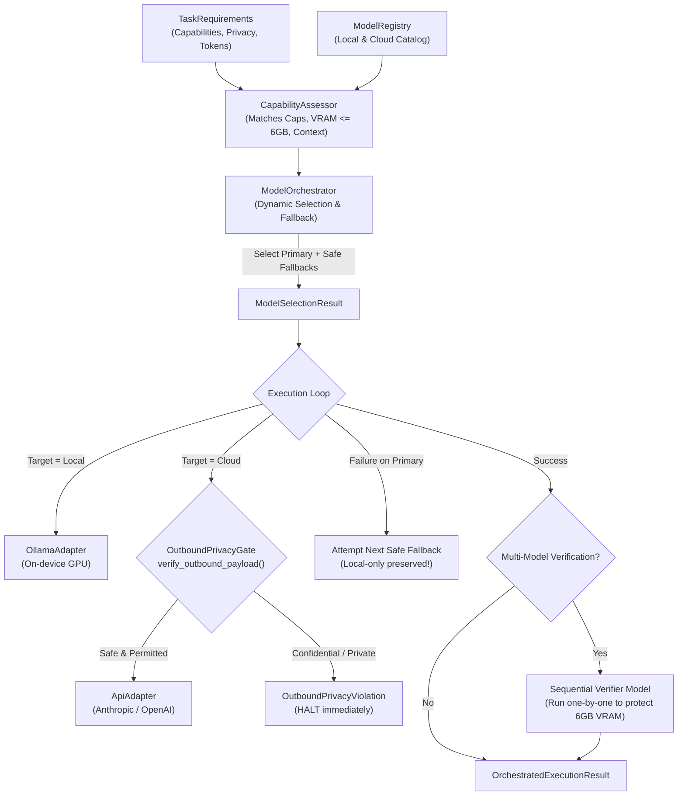

# HINAKU — Phase 1 Milestone 5 Completion & Acceptance Report
**Milestone:** Milestone 5 — Adaptive Model Orchestration  
**Branch:** `phase-1-intelligence-foundation`  
**Date:** November 21, 2026  
**Status:** Completed & Verified  

---

## 1. Executive Summary

Milestone 5 establishes HINAKU's **Adaptive Model Orchestration** foundation, enabling HINAKU to dynamically select, coordinate, and monitor AI models based on task requirements, environmental constraints, and privacy boundaries.

In accordance with Phase 1 architecture principles:
1. **Model Independence:** Models are replaceable cognitive tools used by HINAKU. They do not store HINAKU's identity, personal memory, decision logs, or knowledge graph.
2. **Physical Privacy Gate Integration:** If a task requires local execution—or involves confidential/restricted project context or personal memories—the orchestrator strictly blocks external cloud dispatch. Under NO circumstances do local failures fall back to cloud models.
3. **Hardware Constraint Enforcement:** Local model deployment strictly honors the target laptop's 6.0 GB VRAM ceiling (NVIDIA RTX 4050). Multi-model verification executes sequentially rather than concurrently, preventing GPU memory exhaustion.
4. **Passive Model Discovery with Review Gating:** When new local models are discovered via Ollama, they are registered with `PENDING_REVIEW` status. They are never automatically promoted, authorized, or executed for production tasks without explicit owner confirmation.
5. **Contextual Capability Assessment:** Models are evaluated dynamically against task requirements without arbitrary universal weights.

---

## 2. Files Created and Modified

### Created Source Files
- [`backend/intelligence/orchestrator_types.py`](file:///d:/HINAKU-AI/backend/intelligence/orchestrator_types.py):
  - Enums: `ModelExecutionTarget` (`LOCAL`, `CLOUD`), `ModelAvailability` (`AVAILABLE`, `UNAVAILABLE`, `DEGRADED`, `DISCOVERED`), `ModelApprovalStatus` (`APPROVED`, `PENDING_REVIEW`, `PROHIBITED`), `ModelCapability` (`REASONING`, `CODING`, `FAST_INFERENCE`, `DETAILED_EXPLANATION`, `STRUCTURED_OUTPUT`, `FUNCTION_CALLING`, `VISION`).
  - Dataclasses: `ModelMetadata`, `TaskRequirements`, `CapabilityAssessment`, `ModelSelectionResult`, `OrchestratedExecutionResult`.
- [`backend/intelligence/model_registry.py`](file:///d:/HINAKU-AI/backend/intelligence/model_registry.py):
  - Centralized model tracking with default canonical profiles (`bonsai-2:9b`, `gemma3:4b`, `qwen3.5:4b`, `llama3.2:3b`, `qwen2.5-coder:3b`, `claude-3-5-sonnet`, `gpt-4o`, `gpt-4o-mini`).
  - Implements passive local model discovery gating (`discover_local_models`) assigning `PENDING_REVIEW` to new models.
- [`backend/intelligence/capability_assessor.py`](file:///d:/HINAKU-AI/backend/intelligence/capability_assessor.py):
  - Assesses candidate models against task requirements: capability coverage, context window sufficiency, privacy compliance, owner approval, availability, and hardware limits (6.0 GB VRAM ceiling).
  - Computes contextual fitness scores without arbitrary fixed ranking.
- [`backend/intelligence/model_orchestrator.py`](file:///d:/HINAKU-AI/backend/intelligence/model_orchestrator.py):
  - Integrates `ModelRegistry`, `CapabilityAssessor`, `OutboundPrivacyGate`, `OllamaAdapter`, and `ApiAdapter`.
  - Coordinates task model selection, manual override validation, controlled fallback chains, and sequential multi-model verification.
- [`tests/test_model_orchestration.py`](file:///d:/HINAKU-AI/tests/test_model_orchestration.py):
  - 10 targeted test cases verifying model registration, passive discovery gating, capability matching, hardware boundaries, privacy gate enforcement, safe fallback, and sequential verification.

### Modified Files
- [`backend/intelligence/errors.py`](file:///d:/HINAKU-AI/backend/intelligence/errors.py): Added `ModelSelectionError`, `ModelExecutionError`, `HardwareConstraintViolation`, and `UnsuitableModelError`.
- [`backend/intelligence/__init__.py`](file:///d:/HINAKU-AI/backend/intelligence/__init__.py): Exported all Milestone 5 types, errors, registry, assessor, and orchestrator components.
- [`docs/milestone_reports/README.md`](file:///d:/HINAKU-AI/docs/milestone_reports/README.md): Updated index.

---

## 3. Architecture & Data Contracts

---

## 4. Key Invariants & Enforced Policies

| Policy / Constraint | Architectural Enforcement |
| :--- | :--- |
| **Physical Privacy Gate** | If `local_only_required=True` (or project is `CONFIDENTIAL`/`RESTRICTED` or conversation is `is_private=True`), only `LOCAL` models can be selected. Fallback lists are strictly scrubbed of cloud models. If all local models fail, execution halts; it NEVER falls back to cloud. |
| **Hardware Ceilings** | Enforces `min_vram_gb <= 6.0` on local models for the target RTX 4050. Any model exceeding this ceiling is flagged `hardware_compliant=False` and rejected. |
| **Sequential Verification** | Multi-model verification executes sequentially rather than concurrently, preventing simultaneous model loading in VRAM. |
| **Passive Model Discovery Gating** | Local models discovered through Ollama tags are tagged `PENDING_REVIEW` and cannot be selected or executed until explicitly approved by the owner. |
| **Manual Override Boundaries** | Manual owner model overrides are validated against privacy and hardware boundaries. An override attempting to route confidential data to an external cloud model is rejected with `ModelSelectionError`. |

---

## 5. Verification & Acceptance Results

### Unit Test Execution
- **File:** [`tests/test_model_orchestration.py`](file:///d:/HINAKU-AI/tests/test_model_orchestration.py)
- **Status:** **10 Passed, 0 Failed** in 6.39s.

### Full Intelligence Test Suite Regression (Milestones 1–5)
- **Files:** `tests/test_intelligence_foundation.py`, `tests/test_project_intelligence.py`, `tests/test_memory_knowledge_architecture.py`, `tests/test_decision_planning.py`, `tests/test_model_orchestration.py`
- **Status:** **58 Passed, 0 Failed** in 26.76s.

---

## 6. Next Steps

With Milestone 5 successfully implemented and verified:
- Review report with owner.
- Stand by for commit and push authorization.
- Prepare for Milestone 6: Controlled Learning & Model Adaptation.
