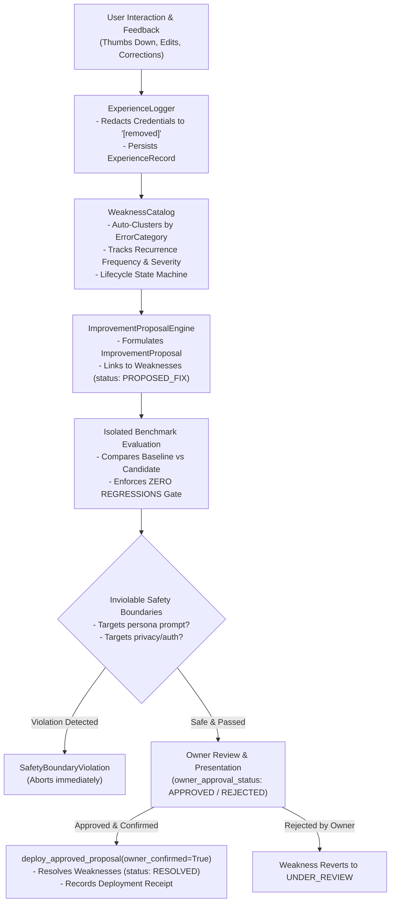

# HINAKU — Phase 1 Milestone 6 Completion & Acceptance Report
**Milestone:** Milestone 6 — Controlled Learning Foundation  
**Branch:** `phase-1-intelligence-foundation`  
**Date:** November 21, 2026  
**Status:** Completed & Verified  

---

## 1. Executive Summary

Milestone 6 establishes HINAKU's **Controlled Learning Foundation**, giving HINAKU the ability to capture interaction experience from user corrections and ratings, catalog recurring failure modes, formulate candidate improvement proposals, and evaluate them in isolated benchmark harnesses without granting autonomous modification rights.

In accordance with Phase 1 Master Implementation Plan Section 10 & 13:
1. **Data, Not Permissions (Anti-Autonomy Invariant):** Experience records, cataloged weaknesses, and improvement proposals are descriptive audit data. They **never** convey autonomous authority to alter code, prompt definitions, or system configurations.
2. **Inviolable Core System Protection:**
   - Any proposal or candidate change attempting to alter the core persona prompt ([`config/hinaku_persona.md`](file:///d:/HINAKU-AI/config/hinaku_persona.md)) is unconditionally rejected with `SafetyBoundaryViolation`.
   - Security policies, authorization scopes ([`backend/security/auth.py`](file:///d:/HINAKU-AI/backend/security/auth.py)), and outbound privacy gates ([`backend/models/privacy_gate.py`](file:///d:/HINAKU-AI/backend/models/privacy_gate.py)) are hard-coded inviolable boundaries.
3. **Decoupled Observation vs Inference:** Observed explicit user feedback is stored as factual records, whereas failure mode classifications are treated as assistant hypotheses with confidence bounds.
4. **Credential Redaction on Ingestion:** Sensitive data (passwords, PINs, card numbers, API keys) in observed feedback is sanitized to `[removed]` before disk persistence.
5. **Zero-Regression Evaluation Gate:** Candidate improvements are evaluated in an isolated workflow against benchmark test suites. Zero regressions on previously passing tests are permitted for a candidate to achieve `PASSED` status.
6. **Explicit Owner Authorization for Deployment:** Deployment strictly requires explicit owner confirmation (`owner_confirmed=True`), failing closed with `CriticalApprovalRequiredError` otherwise.

---

## 2. Files Created and Modified

### Created Source Files
- [`backend/intelligence/learning_types.py`](file:///d:/HINAKU-AI/backend/intelligence/learning_types.py):
  - Enums: `FeedbackType`, `ErrorCategory`, `WeaknessSeverity`, `WeaknessStatus`, `ProposalChangeCategory`, `ProposalEvaluationStatus`, `ProposalApprovalStatus`.
  - Dataclasses: `ExperienceRecord`, `WeaknessRecord`, `ImprovementProposal`.
  - Security validators preventing secret credentials in metadata and enforcing protected target patterns.
- [`backend/intelligence/experience_logger.py`](file:///d:/HINAKU-AI/backend/intelligence/experience_logger.py):
  - SQLite persistence for `experience_records`.
  - Automatic credential redaction via `check_and_redact_sensitive_data()`.
  - Filtered queries and owner full data wipe methods (`delete_experience`, `clear_all_experiences`).
- [`backend/intelligence/weakness_catalog.py`](file:///d:/HINAKU-AI/backend/intelligence/weakness_catalog.py):
  - SQLite persistence for `weakness_records`.
  - Automated experience clustering, recurrence tracking, and severity escalation.
  - Lifecycle state management (`IDENTIFIED` $\to$ `UNDER_REVIEW` $\to$ `PROPOSED_FIX` $\to$ `RESOLVED` / `IGNORED`).
- [`backend/intelligence/improvement_engine.py`](file:///d:/HINAKU-AI/backend/intelligence/improvement_engine.py):
  - SQLite persistence for `improvement_proposals`.
  - Formulation, validation, isolated benchmark evaluation, zero-regression gating, and owner-confirmed deployment.
- [`tests/test_controlled_learning.py`](file:///d:/HINAKU-AI/tests/test_controlled_learning.py):
  - 27 comprehensive unit tests covering all components, safety boundaries, credential redaction, and anti-autonomy guards.

### Modified Files
- [`backend/intelligence/errors.py`](file:///d:/HINAKU-AI/backend/intelligence/errors.py): Added `SafetyBoundaryViolation` and `ImprovementEvaluationError`.
- [`backend/intelligence/__init__.py`](file:///d:/HINAKU-AI/backend/intelligence/__init__.py): Exported all Milestone 6 types, errors, loggers, catalogs, and engines.
- [`docs/milestone_reports/README.md`](file:///d:/HINAKU-AI/docs/milestone_reports/README.md): Updated index.

---

## 3. Architecture & Data Contracts

---

## 4. Key Invariants & Enforced Policies

| Policy / Constraint | Architectural Enforcement |
| :--- | :--- |
| **Inviolable Core Persona** | Modifications targeting `config/hinaku_persona.md` raise `SafetyBoundaryViolation`. Self-modification of core identity is strictly prohibited. |
| **Protected Privacy & Auth** | Candidate changes targeting `privacy_gate.py`, authentication, or critical owner actions raise `SafetyBoundaryViolation`. |
| **Anti-Autonomy Invariant** | `ImprovementProposal.is_authorized_to_execute()` strictly returns `False`. Deployment without explicit owner confirmation (`owner_confirmed=True`) raises `CriticalApprovalRequiredError`. |
| **Zero Regression Gate** | Any regression on previously passing baseline tests forces candidate evaluation status to `FAILED`. |
| **Credential Sanitization** | User feedback containing passwords, PINs, card numbers, or API keys is redacted to `[removed]` before SQLite persistence. |
| **Privacy Full-Wipe** | Full data deletion is supported via `clear_all_experiences()` and `clear_all_weaknesses()`. |

---

## 5. Verification & Acceptance Results

### Unit Test Execution
- **File:** [`tests/test_controlled_learning.py`](file:///d:/HINAKU-AI/tests/test_controlled_learning.py)
- **Status:** **27 Passed, 0 Failed** in 15.66s.

### Full Intelligence Test Suite Regression (Milestones 1–6)
- **Files:** `tests/test_intelligence_foundation.py`, `tests/test_project_intelligence.py`, `tests/test_memory_knowledge_architecture.py`, `tests/test_decision_planning.py`, `tests/test_model_orchestration.py`, `tests/test_controlled_learning.py`
- **Status:** **85 Passed, 0 Failed** in 40.36s.

---

## 6. Next Steps

With Milestone 6 successfully implemented and verified:
- Review completion report with owner.
- Await Git commit and push authorization for Milestone 6.
- Prepare for Phase 1, Milestone 7: Integration, Desktop UI & Hardening.
